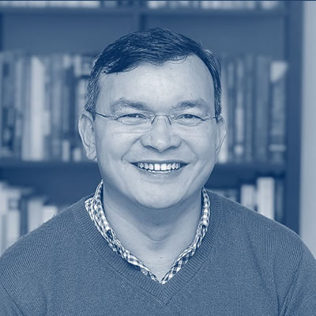
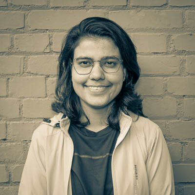
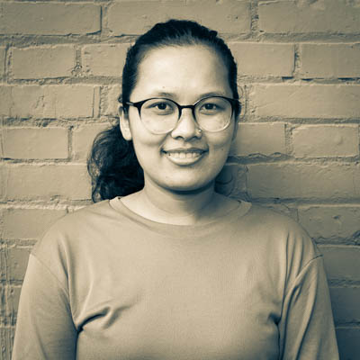
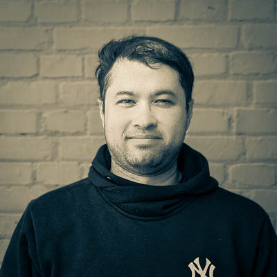
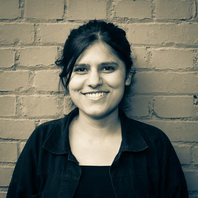
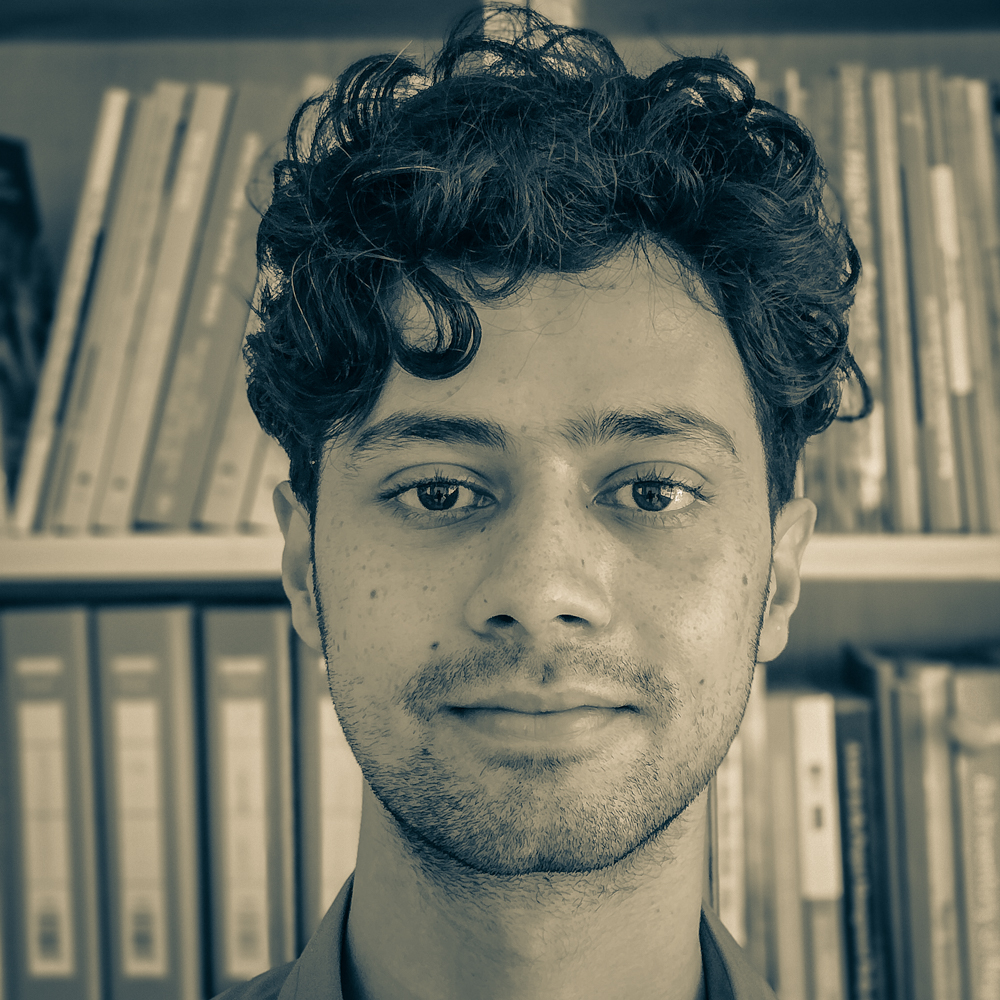
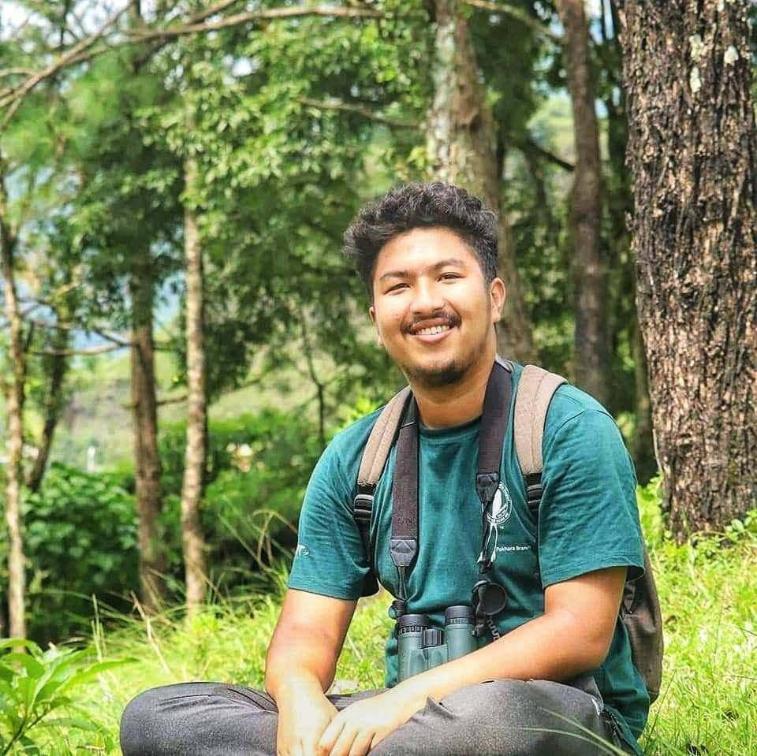
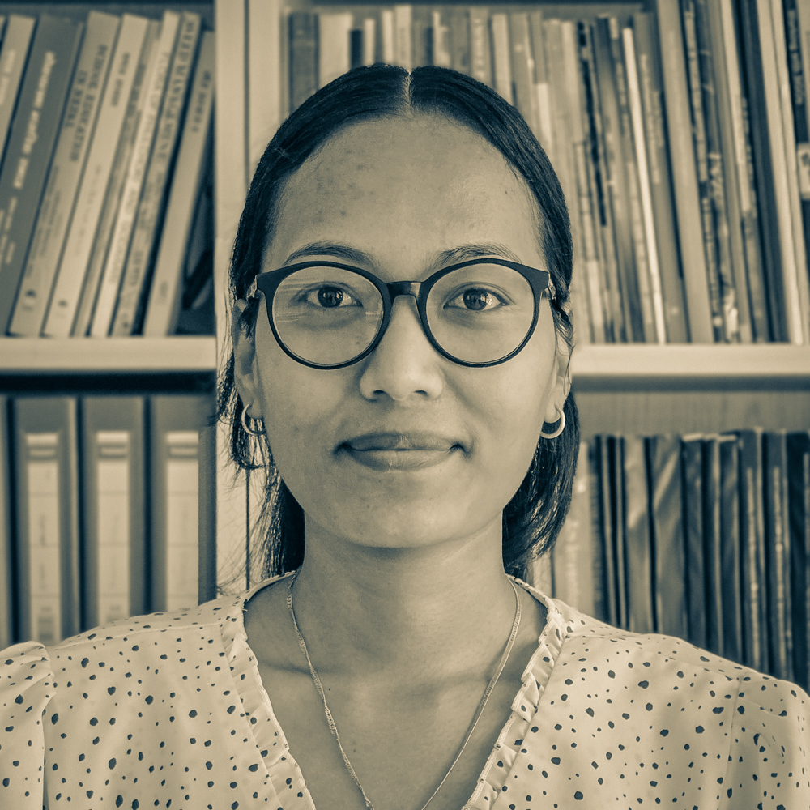

## About GIIS

The Global Institute for Interdisciplinary Studies (GIIS) is an educational institution based in Kathmandu, Nepal. GIIS promotes and conducts interdisciplinary research to generate credible, salient and legitimate knowledge that catalyzes a transformative change in the developmental policies and practices in Nepal and elsewhere. Through deep engagement with decision makers and multiple stakeholders, GIIS aims to shape developmental agenda that is socially-just, environmentally sustainable, and economically viable. Our interdisciplinary team has a strong track record of extensive research in Climate change and Landuse change, Natural resources and the Environment, Geohazards and Disasters, Society and Migration, Global health and Nutrition, Gender and Equality. Currently, we have 15 research fellows and our team is gradually expanding

## Our People

::: {.people-grid}

::: {.person}
[{.person-photo fig-alt="Uttam Babu Shrestha"}](https://www.facebook.com/ubshrestha){target="_blank"}

[[Uttam Babu Shrestha](https://www.facebook.com/ubshrestha){target="_blank"}]{.person-name}
[Research Fellow]{.person-role}
[Climate Change · Land Use change · Rangelands]{.person-areas}
:::

::: {.person}
[{.person-photo fig-alt="Sujata Shrestha"}](https://www.linkedin.com/in/sujata-shrestha-072b5416b){target="_blank"}

[[Sujata Shrestha](https://www.linkedin.com/in/sujata-shrestha-072b5416b){target="_blank"}]{.person-name}
[Research Fellow]{.person-role}
[Natural Resources Management]{.person-areas}
:::

::: {.person}
[{.person-photo fig-alt="Uma Dungel"}](https://www.linkedin.com/in/uma-dhungel-a05048411){target="_blank"}

[[Uma Dungel](https://www.linkedin.com/in/uma-dhungel-a05048411){target="_blank"}]{.person-name}
[Research Associate]{.person-role}
[Social Science . Environmental Management]{.person-areas}
:::

::: {.person}
[{.person-photo fig-alt="Tulasha Chaudhary"}](https://www.linkedin.com/in/tulasa-chaudhary-754a47344){target="_blank"}

[[Tulasha Chaudhary](https://www.linkedin.com/in/tulasa-chaudhary-754a47344){target="_blank"}]{.person-name}
[Research Associate]{.person-role}
[Plant Invasion Ecology]{.person-areas}
:::

::: {.person}
[{.person-photo fig-alt="Prience Shrestha"}](https://prienceshrestha.wordpress.com){target="_blank"}

[[Prience Shrestha](https://prienceshrestha.wordpress.com){target="_blank"}]{.person-name}
[Research Associate]{.person-role}
[Development, Economics, Environmental Governance]{.person-areas}
:::

::: {.person}
[{.person-photo fig-alt="Suraj Joshi"}](https://suraj-geors.streamlit.app){target="_blank"}

[[Suraj Joshi](https://suraj-geors.streamlit.app){target="_blank"}]{.person-name}
[Research Associate]{.person-role}
[Geospatial Technologies · Vegetation Characterisation & Dynamics · Land-Use Change]{.person-areas}
:::

::: {.person}
[{.person-photo fig-alt="Sanjita Khanal"}](https://risingnepaldaily.com/news/66061){target="_blank"}

[[Sanjita Khanal](https://risingnepaldaily.com/news/66061){target="_blank"}]{.person-name}
[Research Associate]{.person-role}
[Freshwater System]{.person-areas}
:::

::: {.person}
[{.person-photo fig-alt="Jeevan Katel"}](https://github.com/jeevankatel3-cell){target='_blank'}

[[Jeevan Katel](https://github.com/jeevankatel3-cell){target='_blank'}]{.person-name}
[Research Associate]{.person-role}
[Data Science . Spatial  Modelling]{.person-areas}
:::

::: {.person}
[{.person-photo fig-alt="Anush Udaya"}](https://www.linkedin.com/in/anush-udaya-99733922b){target='_blank'}

[[Anush Udaya](https://www.linkedin.com/in/anush-udaya-99733922b){target='_blank'}]{.person-name}
[Research Associate]{.person-role}
[Human-Wildlife Conflict]{.person-areas}
:::

::: {.person}
{.person-photo fig-alt="Chandrawati Shrestha"}

[Chandrawati Shrestha]{.person-name}
[Administration and Finance Officer]{.person-role}
:::

:::