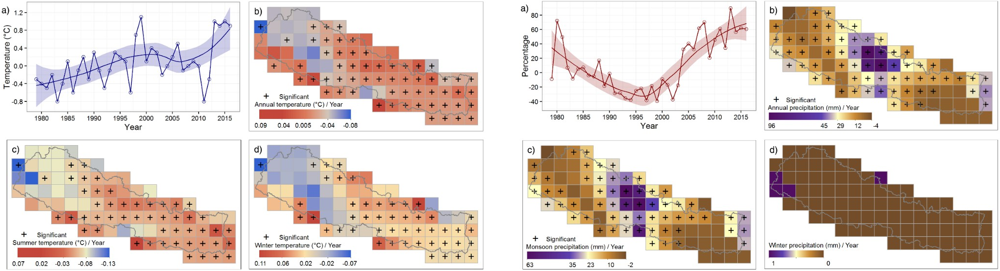
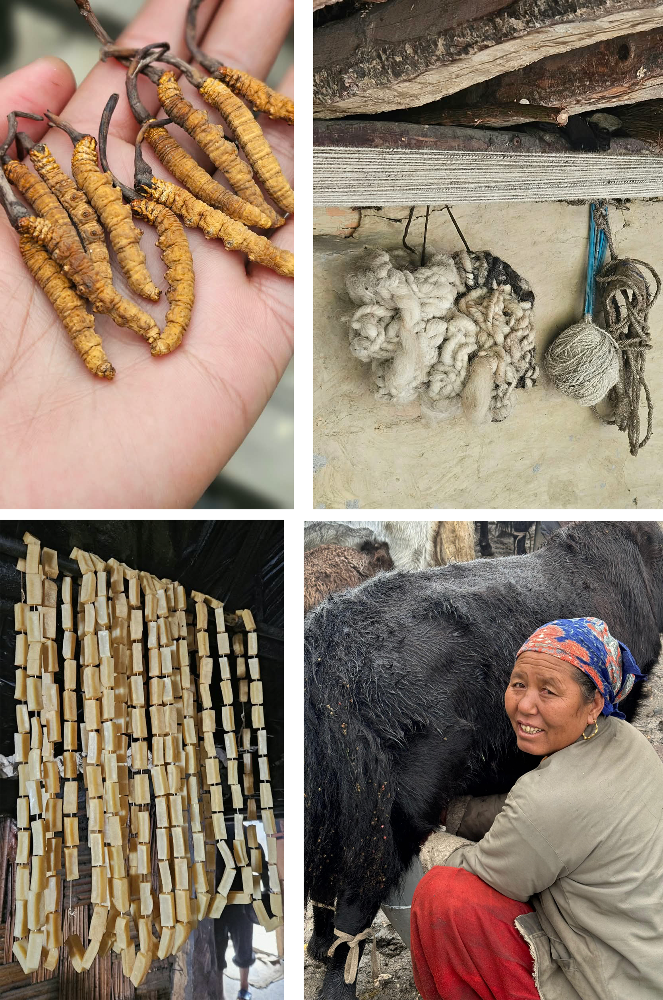

  
:::{.cr-section .hero-section layout="overlay-center"}

**Rangelands in Change**\
*Vegetation trends, pastoral livelihoods and pathways for management​ in Nepal.*\ 
{.hero-logo} @cr-bg

:::{#cr-bg .full-bg}

:::

:::

::: {.cr-section layout="sidebar-left" .rangeland-nepal}

:::{#cr-services .services}
::: {.svc-group .svc-material}
[Material]{.svc-title}
[Materials]{.chip} [Medicinal species]{.chip} [Food & feed]{.chip} [Energy source]{.chip} 
:::
::: {.svc-group .svc-nonmaterial}
[Non-material]{.svc-title}
[Learning]{.chip} [Culture & identity]{.chip} [Experience]{.chip}
:::
::: {.svc-group .svc-regulating}
[Regulating]{.svc-title}
[Habitats]{.chip} [Water regulation]{.chip} [Pollination]{.chip} [Sequestration]{.chip} [Soil formation]{.chip}
:::
:::

:::{#cr-photo-placeholder}

:::

:::{#cr-photo-climateChange}

:::
 
:::{#cr-photo-dryingLake}

:::

:::{#cr-map}
```{python}
import importlib
import scripts.maps as maps
 
importlib.reload(maps)
maps.make_map()
``` 
:::
 
Rangelands are diverse in their vegetation driven by highly fluctuating rainfall, temperature and other climate phenomena, and influenced by soils and management practices. They cover about 54% of global terrestrial surface (148,326,000 km2) to a total of 79,509,421 km2. @cr-photo-placeholder
 
Rangelands provide a wide range of ecosystem services including forage, water, carbon storage, biodiversity habitat, and cultural value. @cr-services

 

### Distribution
[Nepal's rangelands span the high-altitude Trans-Himalayan belt down to the mid-hills, covering critical ecological and pastoral gradients.]{.map-step data-view="nat"} @cr-map Nationally, they support extensive livestock production and wildlife corridors. <span class="rangeland-stats"><strong>2.1 M ha</strong>Total rangeland area<br><br><strong>14%</strong>of Nepal<br><br></span>

[Climate Change]{.cr-title}
Content. @cr-photo-climateChange

Content. @cr-photo-dryingLake
  
### The Karnali Province
[Karnali Province, the largest province in Nepal, is home to diverse rangeland ecosystems.]{.map-step data-view="karnali"} These areas are vital for local livelihoods, supporting pastoral communities and serving as habitats for endemic species. @cr-map

### Our Ecological Survey and Restoration Sites Rangelands
[We conducted field surveys across various rangeland sites of Jumla and Dolpa districts in Karnali,]{.map-step data-view="field"} focusing on vegetation composition, soil health, grazing patterns. Furthermore we did couple of rangeland restoration projects. @cr-map

### Restoration Work 
[We did restoration ...]{.map-step data-view="restoration"} Some Photos/plots. @cr-map

[Thulo Guthichaur]{.cr-title}
[Content...]{.map-step data-view="thuloguthi"}. @cr-map

[Patrasi]{.cr-title}
[Content...]{.map-step data-view="patrasi"}. @cr-map

:::

```{=html}
<script>
(function () {
  var current = null;
  function go(view) {
    if (view === current) return;
    var frame = document.querySelector("#cr-map iframe");
    if (frame && frame.contentWindow && frame.contentWindow.goToView) {
      frame.contentWindow.goToView(view);
      current = view;
    }
  }
  window.addEventListener("load", function () {
    var io = new IntersectionObserver(function (entries) {
      entries.forEach(function (e) {
        if (e.isIntersecting) go(e.target.dataset.view);
      });
    }, { rootMargin: "-40% 0px -40% 0px" });   // fires when the span is near mid-screen
    document.querySelectorAll(".map-step").forEach(function (el) { io.observe(el); });
  });
})();

window.addEventListener("load", function () {
  var el = document.getElementById("cr-services");
  if (!el) return;
  function sync() {
    var want = el.classList.contains("cr-active");
    if (want !== el.classList.contains("in")) el.classList.toggle("in", want);
  }
  new MutationObserver(sync).observe(el, { attributes: true, attributeFilter: ["class"] });
  sync();
});
</script>
```