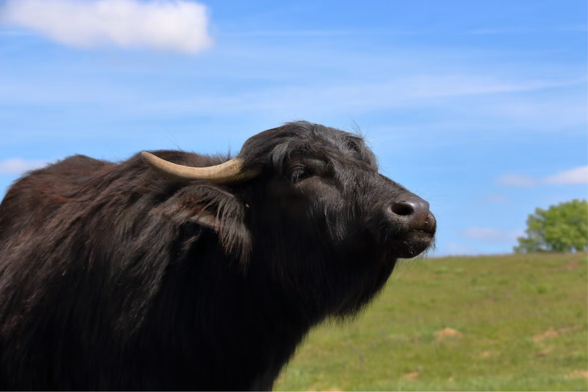
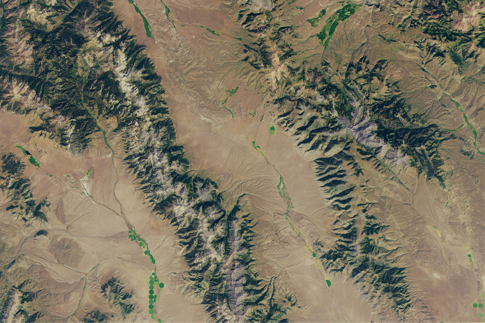

:::{.cr-section .hero-section layout="overlay-center"}

**Rangelands in Change**\
*Exploring Earth's most extensive socio-ecological systems.* @cr-bg

:::{#cr-bg .full-bg}

:::

:::

:::{.cr-section .section-white layout="overlay-right"}

## What are rangelands? {.section-title-left}

Rangelands represent the most extensive land cover type on Earth.<br><br>
Stoddard et al. (1975) define rangelands as ‘those areas of the world which, due to physical limitations such as low and erratic precipitation, rough topography, poor drainage, or cold temperatures are unsuited to cultivation and serve as a source of forage for native and domestic animals as well as a source of wood products, water, and wildlife’.<br><br>
Globally, rangelands cover approximately 25-54% of the
terrestrial surface, depending on the definition used (AlBukhari et al. 2018; Gamoun et al. 2018; Tiscornia et al.
2019; Briske et al. 2020; ILRI 2021).<br><br>
These rangelands are critical socio-ecological systems due to their economic, environmental, and socio-cultural importance. @cr-bg2

:::{#cr-bg2 .full-bg}

:::

:::

::: {.cr-section layout="sidebar-left"}

### Rangelands of Nepal
Nepal’s rangelands span the high-altitude Trans-Himalayan belt down to the mid-hills, covering critical ecological and pastoral gradients. Nationally, they support extensive livestock production and wildlife corridors. @cr-map-nat

### Provincial Dynamics: Karnali Province
Karnali Province, the largest province in Nepal, is home to diverse rangeland ecosystems. These areas are vital for local livelihoods, supporting pastoral communities and serving as habitats for endemic species. @cr-map-karnali

### Field Surveyed Rangelands
We conducted field surveys across various rangeland sites in Nepal, focusing on vegetation composition, soil health, and grazing patterns. These surveys provide ground-truth data to validate remote sensing analyses. @cr-map-field

:::{#cr-map-nat}
```{python}
import leafmap.foliumap as leafmap
from branca.element import Element, MacroElement
from jinja2 import Template
import geopandas as gpd
import os
from dotenv import load_dotenv

load_dotenv()
STADIA_API_KEY = os.getenv("STADIA_API_KEY")
provinces = gpd.read_file(r"data/province_bounds_json.geojson")

# minx, miny, maxx, maxy = provinces.total_bounds
# provinces_bounds = [[miny, minx], [maxy, maxx]]
# center_lat = (miny + maxy) / 2
# center_lon = (minx + maxx) / 2
# 1. Increase map height to fill the viewport
m_nat = leafmap.Map(
    # center=[center_lat, center_lon],
    # zoom=5,
    # height=1000,
    tiles = None
)
m_nat.add_basemap("Stadia.StamenTerrain", api_key=STADIA_API_KEY)

m_nat.add_raster(
    r"data\nepal_rangeland_image.tif",
    layer_name="Nepal Rangelands",
    vmin=1,
    vmax=1,
    nodata=0,
    colormap=["#1eff87", "#1eff87"],
    opacity=1.0,
    zoom_to_layer=False,
)

m_nat.add_gdf(
    provinces,
    layer_name="Provinces",
    style={
        "color": "#ffffff",
        "weight": 2.5,
        "fillOpacity": 0.0,
        "dashArray": "5, 5",
        
    },
    zoom_to_layer=False,
    info_mode=None
)
# 3. Force full-screen size recalculation and centering
class RecenterMap(MacroElement):
    def __init__(self, lat, lon, zoom):
        super().__init__()
        self._template = Template(f"""
            {}
            window.addEventListener("load", function() {{
                setTimeout(function() {{
                    var map = {{{{ this._parent.get_name() }}}};
                    map.invalidateSize();
                    map.setView([{lat}, {lon}], {zoom});
                }}, 300);
            }});
            {}
        """) 

m_nat.add_child(RecenterMap(28.165295, 84.470657, 7))
 
# 4. Inject Multiply blend mode for the 2nd layer (your raster)
blend_css = Element("""
<style>
  .leaflet-tile-pane .leaflet-layer:nth-child(2) {
      mix-blend-mode: multiply;
  }
</style>
""")
m_nat.get_root().html.add_child(blend_css)

# 5. Render the map as the final expression in the cell
m_nat
```
:::

:::{#cr-map-karnali}
```{python}
import leafmap.foliumap as leafmap
from branca.element import Element, MacroElement
from jinja2 import Template
import geopandas as gpd
import os
from dotenv import load_dotenv

load_dotenv()
STADIA_API_KEY = os.getenv("STADIA_API_KEY")
provinces = gpd.read_file(r"data/province_bounds_json.geojson")
karnali = provinces[provinces['name_eng'] == 'Karnali'] #already in WGS84

minx, miny, maxx, maxy = karnali.total_bounds
karnali_bounds = [[miny, minx], [maxy, maxx]]
center_lat = (miny + maxy) / 2
center_lon = (minx + maxx) / 2

# 1. Increase map height to fill the viewport
m_karnali = leafmap.Map(
    # center=[center_lat, center_lon],
    # zoom=8,
    # height=1000, 
    tiles = None
)
m_karnali.add_basemap("Stadia.StamenTerrain", api_key=STADIA_API_KEY)

m_karnali.add_raster(
    r"data\nepal_rangeland_image.tif",
    layer_name="Nepal Rangelands",
    vmin=1,
    vmax=1,
    nodata=0,
    colormap=["#1eff87", "#1eff87"],
    opacity=1.0,
    zoom_to_layer=False,
)

m_karnali.add_gdf(
    karnali,
    layer_name="Karnali Province",
    style={
        "color": "#ffffff",
        "weight": 2.5,
        "fillOpacity": 0.0,
        "dashArray": "5, 5"
    },
    info_mode=None
)

# 5. Scroll-aware resize & fitBounds macro (prevents gray tiles when revealed on scroll) (has no effect so commented)
# class FitBoundsOnReveal(MacroElement):
#     def __init__(self, bounds):
#         super().__init__()
#         self._template = Template(f"""
#             {}
#             function adjustMap() {{
#                 var map = {{{{ this._parent.get_name() }}}};
#                 map.invalidateSize();
#                 map.fitBounds({bounds}, {{padding: [25, 25]}});
#             }}
#             window.addEventListener("load", function() {{
#                 setTimeout(adjustMap, 300);
#             }});
#             var container = document.getElementById("{{{{ this._parent.get_name() }}}}");
#             if (container && typeof ResizeObserver !== "undefined") {{
#                 var ro = new ResizeObserver(function() {{
#                     adjustMap();
#                 }});
#                 ro.observe(container);
#             }}
#             {}
#         """)

# 3. Force full-screen size recalculation and centering
class RecenterMap(MacroElement):
    def __init__(self, lat, lon, zoom):
        super().__init__()
        self._template = Template(f"""
            {}
            window.addEventListener("load", function() {{
                setTimeout(function() {{
                    var map = {{{{ this._parent.get_name() }}}};
                    map.invalidateSize();
                    map.setView([{lat}, {lon}], {zoom});
                }}, 300);
            }});
            {}
        """)

# m_karnali.add_child(FitBoundsOnReveal(karnali_bounds))
m_karnali.add_child(RecenterMap(29.049975, 82.151980, 8))
# 4. Inject Multiply blend mode for the 2nd layer (your raster)
blend_css = Element("""
<style>
  .leaflet-tile-pane .leaflet-layer:nth-child(2) {
      mix-blend-mode: multiply;
  }
</style>
""")
m_karnali.get_root().html.add_child(blend_css)

# 5. Render the map as the final expression in the cell
m_karnali
```

:::

:::{#cr-map-field}
```{python}
import leafmap.foliumap as leafmap
import folium
from branca.element import Element, MacroElement
from jinja2 import Template
import geopandas as gpd
import os
from dotenv import load_dotenv

load_dotenv()
STADIA_API_KEY = os.getenv("STADIA_API_KEY")
provinces = gpd.read_file(r"data/province_bounds_json.geojson")
karnali = provinces[provinces['name_eng'] == 'Karnali'] #already in WGS84
field_sites = gpd.read_file(r"data\eco_survey_sites_json.geojson")

# 1. Increase map height to fill the viewport
m_field = leafmap.Map(
    # center=[center_lat, center_lon],
    # zoom=8,
    # height=1000, 
    tiles = None
)
m_field.add_basemap("Stadia.StamenTerrain", api_key=STADIA_API_KEY)

m_field.add_raster(
    r"data\nepal_rangeland_image.tif",
    layer_name="Nepal Rangelands",
    vmin=1,
    vmax=1,
    nodata=0,
    colormap=["#1eff87", "#1eff87"],
    opacity=1.0,
    zoom_to_layer=False,
)

m_field.add_gdf(
    karnali,
    layer_name="Karnali Province",
    style={
        "color": "#ffffff",
        "weight": 2.5,
        "fillOpacity": 0.0,
        "dashArray": "5, 5"
    },
    info_mode=None
)
m_field.add_gdf(
    field_sites,
    layer_name="Field Survey Sites",
    style={
        "color": "#fd0000",
        "weight": 2.5,
        "fillOpacity": 0.0,
        "dashArray": "5, 5"
    },
    info_mode=None
)

for _, row in field_sites.iterrows():
    pt = row.geometry.representative_point()
    label_text = str(row["pasture"])

    folium.Marker(
        location=[pt.y, pt.x],
        icon=folium.DivIcon(
            icon_size=(0, 0),
            icon_anchor=(0, 36),  # Positive Y moves the label UP (increase for more gap)
            html=f"""
                <div style="
                    transform: translate(-50%, -100%);
                    display: inline-block;
                    font-size: 12pt;
                    font-weight: bold;
                    color: #fd0000;
                    text-shadow: -1px -1px 0 #fff, 1px -1px 0 #fff, -1px 1px 0 #fff, 1px 1px 0 #fff;
                    white-space: nowrap;
                    text-align: center;
                ">{label_text}</div>
            """,
        ),
    ).add_to(m_field)

class RecenterMap(MacroElement):
    def __init__(self, lat, lon, zoom):
        super().__init__()
        self._template = Template(f"""
            {}
            window.addEventListener("load", function() {{
                setTimeout(function() {{
                    var map = {{{{ this._parent.get_name() }}}};
                    map.invalidateSize();
                    map.setView([{lat}, {lon}], {zoom});
                }}, 300);
            }});
            {}
        """)

m_field.add_child(RecenterMap(29.0674303, 82.6130036, 10))
# 4. Inject Multiply blend mode for the 2nd layer (your raster)
blend_css = Element("""
<style>
  .leaflet-tile-pane .leaflet-layer:nth-child(2) {
      mix-blend-mode: multiply;
  }
</style>
""")
m_field.get_root().html.add_child(blend_css)

# 5. Render the map as the final expression in the cell
m_field
```
:::

:::